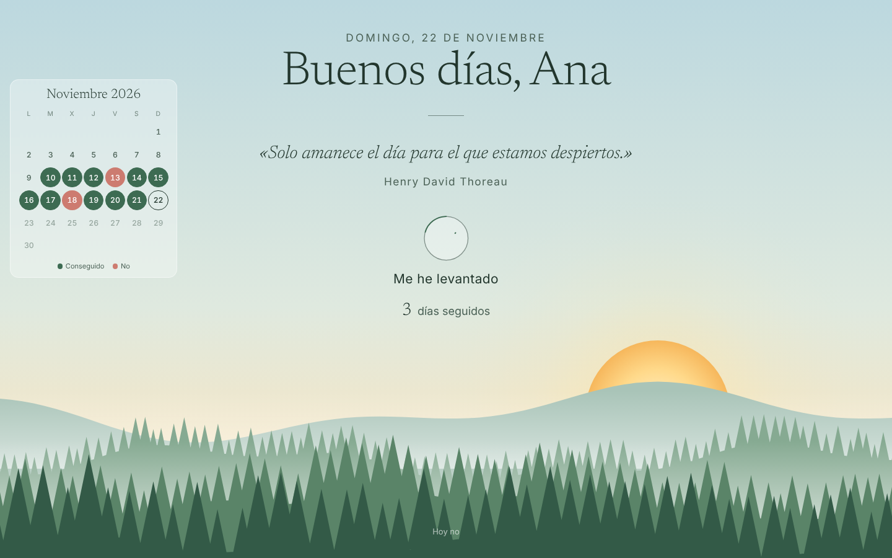

# alba

Cada mañana, a partir de la hora que elijas, aparece un amanecer en el bosque con un saludo, la cita del día y tu racha. Se va cuando marcas **Me he levantado**. Al lado verás el calendario del mes: en verde los días que lo has conseguido y en rojo los que no.

Es gratis, no tiene cuenta ni anuncios y no envía nada a internet: todo se guarda en tu ordenador.



- [Descargar](#descargar)
- [Instalar en Mac (paso a paso)](#instalar-en-mac-paso-a-paso)
- [Instalar en Windows](#instalar-en-windows)
- [Instalar en Linux](#instalar-en-linux)
- [Cómo se usa](#cómo-se-usa)
- [Desactivar o desinstalar](#desactivar-o-desinstalar)

## Descargar

Entra en **[la última versión](../../releases/latest)** y, abajo del todo, en *Assets*, descarga el archivo de tu ordenador:

| Ordenador | Archivo |
|---|---|
| Mac (con chip Apple o Intel) | el que termina en `universal.dmg` |
| Windows | el que termina en `x64-setup.exe` |
| Linux | el `.AppImage` (cualquier distribución) o el `.deb` (Ubuntu, Debian) |

## Instalar en Mac (paso a paso)

alba no está firmada con un certificado de Apple, porque cuesta 99 € al año y esta app es gratis. Por eso la primera vez el Mac no te deja abrirla con doble clic. Es normal y solo hay que hacerlo una vez. Son 2 minutos:

1. **Abre el archivo `.dmg`** que has descargado (estará en *Descargas*). Se abre una ventana con el icono de alba.
2. **Arrastra el icono de alba a la carpeta Aplicaciones** que aparece en esa misma ventana.
3. **Abre alba** desde *Aplicaciones* (o con Cmd + espacio, escribiendo "alba").
4. Saldrá un aviso que dice que **Apple no ha podido verificar** que alba esté libre de software malicioso. **Pulsa "Hecho"** (o "OK"). *No* pulses "Trasladar a la papelera".
5. Abre el **menú Apple ()** arriba a la izquierda → **Ajustes del Sistema**.
6. En la columna de la izquierda, entra en **Privacidad y seguridad**.
7. **Baja hasta el apartado "Seguridad"**, al final de esa página. Verás un mensaje que dice que se ha bloqueado alba. **Pulsa "Abrir igualmente"**.
8. Vuelve a salir un aviso: **pulsa "Abrir igualmente"** otra vez y escribe la contraseña de tu Mac (o usa Touch ID).
9. Listo. alba se abre y te pregunta tu nombre, la hora y los días. A partir de ahora se abre sola al encender el Mac y no vuelve a preguntar nada.

**¿No aparece el botón "Abrir igualmente"?** Sale durante una hora después del aviso del paso 4. Si ha pasado más tiempo, vuelve a abrir alba (paso 3) y repite desde el paso 4.

**¿Te dice que la app "está dañada"?** Pasa a veces con algunos navegadores. Abre la app **Terminal**, pega esta línea, pulsa Intro y vuelve a abrir alba:

```
xattr -dr com.apple.quarantine /Applications/alba.app
```

**¿Dónde está alba después?** Arriba a la derecha, en la barra de menús, junto al reloj, verás un pequeño sol. Desde ahí la controlas (más abajo, en *Cómo se usa*).

## Instalar en Windows

1. Abre el archivo `.exe`.
2. Si aparece "Windows protegió su PC", pulsa **Más información** → **Ejecutar de todas formas**.
3. Sigue el instalador. No pide permisos de administrador.

El sol de alba aparece junto al reloj, abajo a la derecha (puede estar escondido en la flechita **^**).

## Instalar en Linux

- `.AppImage`: dale permiso de ejecución (clic derecho → Propiedades → Permitir ejecutar, o `chmod +x`) y ábrelo.
- `.deb`: `sudo apt install ./alba_….deb`
- En GNOME el sol de la barra solo se ve con la extensión *AppIndicator*. Si no lo ves, abre alba otra vez: se abre la ventana de tu racha, con acceso a los ajustes.

## Cómo se usa

- **Cada mañana**, a partir de tu hora, aparece el amanecer. **Marca el círculo** (o pulsa Intro o espacio) y se va hasta mañana. El día que la instalas no sale.
- **Hoy no:** abajo del todo hay un "Hoy no" discreto. Cierra la pantalla hasta mañana, y ese día sale en rojo.
- **Días libres:** los días que no elijas no sale, aparecen atenuados en el calendario y no rompen la racha.
- **El sol junto al reloj** tiene estas opciones:
  - **Ver mi racha:** una ventana con tu racha, si hoy ya has marcado, el total de mañanas y el calendario del mes. Mirarla no cuenta como marcar. Abrir alba otra vez hace lo mismo.
  - **Ya me he levantado:** marca el día antes de la hora y ese día ya no sale.
  - **Probar ahora:** la ves sin que cuente.
  - **Ajustes…:** nombre, hora, días y si la quieres a pantalla completa o en una ventana.
  - **Desactivar y salir:** deja de abrirse.
- **Compartir tu racha:** en *Ver mi racha*, **Compartir mi racha** copia una imagen en formato historia (bosque, sol, tu racha y el calendario) para pegarla donde quieras, y **Guardar imagen** la guarda como archivo (por defecto, en Imágenes).
- Si el ordenador está apagado o dormido a tu hora, alba aparece al encenderlo o despertarlo.

## Desactivar o desinstalar

- **Desactivar:** sol → **Desactivar y salir**. Deja de abrirse al iniciar sesión. Si un día la vuelves a abrir, se reactiva.
- **Mac:** primero *Desactivar y salir*. Después arrastra alba de *Aplicaciones* a la Papelera.
- **Windows:** Configuración → Aplicaciones → alba → Desinstalar.
- **Linux:** *Desactivar y salir* y borra el `.AppImage`, o `sudo apt remove alba`.

Tus datos (nombre, hora y días marcados) están en:
- Mac: `~/Library/Application Support/app.alba/`
- Windows: `%APPDATA%\app.alba\`
- Linux: `~/.config/app.alba/` y `~/.local/share/app.alba/`

## Para desarrolladores

Hecha con [Tauri 2](https://tauri.app). `npm ci && npm run tauri dev`. Las citas están en `src-tauri/citas.txt` (una por línea: frase, tabulador, autor). Al subir una etiqueta `v*`, GitHub Actions compila y publica los instaladores.

Tipografías: Inter y Newsreader, con licencia SIL Open Font License.
